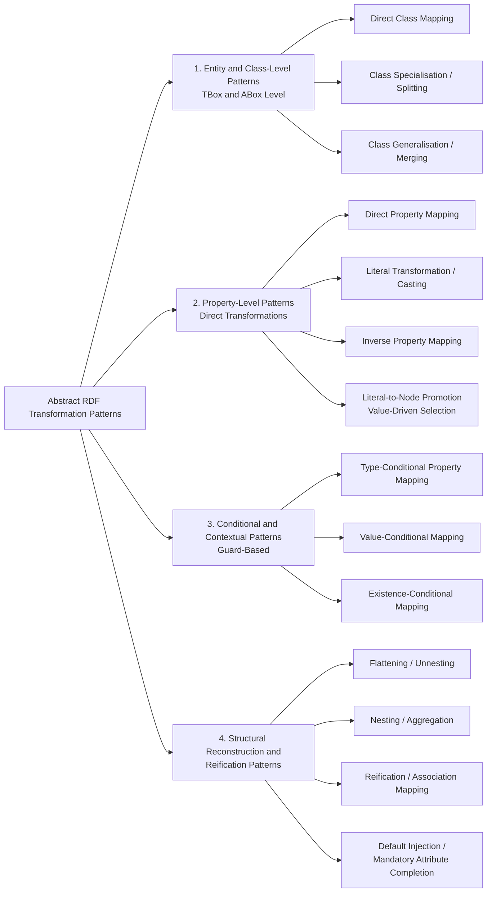
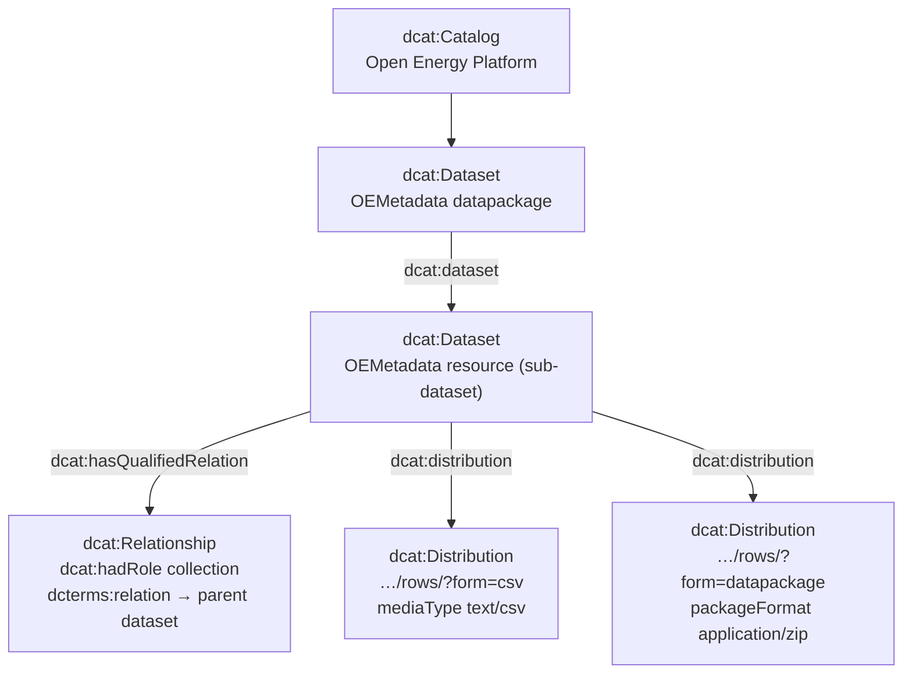

# Metadata Crosswalk - Patterns Map

Moving to an abstract, foundational taxonomy is an excellent strategy before implementing concrete rules. Categorising metadata transformation patterns helps establish a systematic framework for schema interoperability.

Here is a comprehensive catalog of abstract RDF transformation patterns, ranging from simple structural mappings to context-dependent and reification patterns.



---

## Pattern Classification

### 1. Entity and Class-Level Patterns (TBox & ABox Level)

These patterns dictate how instance types and class hierarchies are translated between vocabulary A and vocabulary B.

| Pattern Name | Abstract Definition | Example (Vocabulary A $\rightarrow$ B) |
| --- | --- | --- |
| **Direct Class Mapping** | A 1-to-1 equivalence where an instance of class $C_1$ in $A$ becomes an instance of class $C_2$ in $B$. | `dcat:Dataset` $\rightarrow$ `schema:Dataset` |
| **Class Specialisation / Splitting** | An instance of class $C_1$ is mapped to $C_2$ or $C_3$ in $B$ depending on an internal attribute or property value. | `ex:Publication` $\rightarrow$ `bibo:Article` (if peer-reviewed) vs. `bibo:Report` (otherwise) |
| **Class Generalisation / Merging** | Multiple distinct source classes in $A$ are mapped to a single overarching target class in $B$. | `dcat:Dataset` + `dcat:DataService` $\rightarrow$ `dcterms:Resource` |

---

### 2. Property-Level Patterns (Direct Transformations)

These govern how properties and their literal or object values are transferred.

| Pattern Name                         | Abstract Definition | Example (Vocabulary A $\rightarrow$ B) |
|--------------------------------------| --- | --- |
| **Direct Property Mapping**          | A direct predicate substitution where property $P_1$ maps to $P_2$ with identical value domains. | `dcat:keyword` $\rightarrow$ `schema:keywords` |
| **Literal Transformation / Casting** | The property is mapped, but the value undergoes datatype conversion, formatting, or parsing (e.g., string to URI, date parsing, unit conversion). | `ex:createdDate` (String) $\rightarrow$ `dcterms:created` (XSD DateTime) |
| **Inverse Property Mapping** | The direction of the relation is inverted between subject and object. | `ex:hasAuthor` $\rightarrow$ `dcterms:creator` (with reversed subject/object bindings) |
| **Literal-to-Node Promotion (Value-Driven Selection)** | A literal in the input (typically the object of the source triple) is used as a lookup key to *select* the target subject, predicate, or object — e.g. choosing the target class — instead of (or in addition to) being carried over as a value. The literal is promoted into a node position in the target graph. | `ex:dateType "Collected"` selects predicate `dcterms:created`; `ex:type "service"` instantiates target class `dcat:DataService` in the subject position. |

---

### 3. Conditional and Contextual Patterns (Guard-Based)

These are advanced patterns where the transformation logic depends on graph topology, node types, or property values.

| Pattern Name | Abstract Definition | Example (Vocabulary A $\rightarrow$ B) |
| --- | --- | --- |
| **Type-Conditional Property Mapping** | Property $P_1$ is transformed into $P_2$ **only when** the subject instance possesses a specific rdf:type. | Map `ex:identifier` to `bibo:doi` **only when** the subject has `rdf:type ex:JournalArticle`. |
| **Value-Conditional Mapping** | Property $P_1$ is transformed into $P_2$ **only when** another property $P_3$ matches a specific literal value or regex pattern. | Map `ex:status` to `dcterms:accessRights` **only when** `ex:isPublic` is set to `true`. |
| **Existence-Conditional Mapping** | A target triple is constructed **only if** a mandatory property or related node exists in the source graph. | Generate a provenance statement in $B$ only if `prov:wasGeneratedBy` is populated in $A$. |

---

### 4. Structural Reconstruction and Reification Patterns

These handle structural mismatches where a flat property in one schema becomes a nested or reified structure in another.

| Pattern Name | Abstract Definition | Example (Vocabulary A $\rightarrow$ B) |
| --- | --- | --- |
| **Flattening (Unnesting)** | A nested structure or blank node chain in $A$ is collapsed into direct properties on the main resource in $B$. | `ex:hasDimensions [ ex:width ?w ; ex:height ?h ]` $\rightarrow$ `schema:width ?w`, `schema:height ?h` |
| **Nesting / Aggregation** | Flat properties in $A$ are grouped into a structured blank node or intermediate entity in $B$. | `schema:latitude` + `schema:longitude` $\rightarrow$ `ex:hasLocation [ geo:lat ... ; geo:long ... ]` |
| **Reification / Association Mapping** | A direct property edge in $A$ is transformed into an intermediate reified statement node in $B$ to support qualified metadata. | `ex:dataset ex:hasQualityMetric ?val` $\rightarrow$ `ex:dataset ex:hasQuality [ dqv:metric ... ; dqv:value ?val ]` |
| **Default Injection / Mandatory Attribute Completion** | When an object of target class $C_2$ is instantiated and $C_2$'s schema declares attributes as mandatory (minCount ≥ 1) that are absent in the source, the transformation must inject schema-compliant defaults — minted URIs, fixed literals, fallback datatypes, or derived values — so the generated object remains valid in $B$. | Creating a `dcat:Distribution` requires `dcat:accessURL` and `dcat:mediaType`; if the source resource lacks them, mint `<parent>/rows/?form=csv` and default to `text/csv`. |

---

Here is the extended **OEMetadata Crosswalk** table enhanced with a new **Transformation Pattern** column. This column assigns each row or container group to one of the abstract RDF transformation patterns (Direct Property Mapping, Literal Transformation, Nesting/Aggregation, Flattening/Unnesting, or Reification/Association) established in your study framework.

---

## Enhanced OEMetadata Crosswalk with Transformation Patterns

| # | OEMetadata Key | DCAT-AP.de / Target Schema | DataCite Target | Transformation Pattern |
| --- | --- | --- | --- | --- |
| 1 | name | `dcat:Dataset` | Identifier (DOI/other) | **Direct Property Mapping** |
| 2 | title | `dcat:Dataset / dct:title` | Title | **Direct Property Mapping** |
| 3 | description | `dcat:Dataset / dcterms:description` | Description (Abstract) | **Direct Property Mapping** |
| 4 | id | `dcat:Dataset / dct:identifier` | Identifier | **Direct Property Mapping** |
| 5 | resources | `dcat:Catalog / dcat:dataset` → sub-`dcat:Dataset` (qualified relation via `dcat:Relationship` / `dcat:hadRole collection`; `dcterms:hasPart` kept as documented alternative) | RelatedIdentifier (HasPart) | **Class Specialisation + Reification / Association** |
| 6 | name (resource) | `dcat:Distribution / dcat:accessURL` | – | **Direct Property Mapping** |
| 7 | topics | `dcat:Distribution / dcat:accessURL` | Subject | **Direct Property Mapping** |
| 8 | title (resource) | `dcat:Distribution / dcterms:title` | Title (AlternativeTitle) | **Direct Property Mapping** |
| 9 | path | `dcat:Distribution / dcat:accessURL` | RelatedIdentifier (URL) | **Direct Property Mapping** |
| 11 | languages | `dcat:Distribution / dcterms:language` | Language | **Direct Property Mapping** |
| 12 | **subject** | Datapackage | Subject (Container) | **Nesting / Aggregation** |
| 13 | name (subject) | `dcat:Dataset / dcat:theme` | Subject | **Direct Property Mapping** |
| 14 | @id (subject) | `dcat:Dataset / dcat:theme` | Subject / subjectScheme | **Direct Property Mapping** |
| 15 | keywords | `dcat:Dataset / dcat:keyword` | Subject | **Direct Property Mapping** |
| 16 | publicationDate | `dcat:Distribution / dcterms:issued` | PublicationYear / Date | **Literal Transformation / Casting** |
| 17 | **embargoPeriod** | Datapackage | Date (Container) | **Nesting / Aggregation** |
| 18 | start (embargo) | OEP | Date (Withheld, start) | **Literal Transformation / Casting** |
| 19 | end (embargo) | OEP | Date (Available) | **Literal Transformation / Casting** |
| 21 | **context** | Datapackage | Creator / Contributor | **Nesting / Aggregation** |
| 22 | title (context) | `vcard:fn` | Creator / Contributor Name | **Direct Property Mapping** |
| 23 | homepage | `vcard:hasURL` | nameIdentifier (URL) | **Direct Property Mapping** |
| 24 | documentation | `dcat:Distribution / foaf:page` | RelatedIdentifier (IsDocumentedBy) | **Reification / Association** |
| 25 | sourceCode | `dcat:Distribution / foaf:page` | RelatedIdentifier (IsSupplementTo) | **Reification / Association** |
| 26 | contact | `vcard:hasEmail` | Contributor (ContactPerson) | **Direct Property Mapping** |
| 27 | grantNo | OEP | FundingReference / awardNumber | **Direct Property Mapping** |
| 28 | fundingAgency | OEP | FundingReference / funderName | **Direct Property Mapping** |
| 30 | publisher | `dcat:Dataset / dcat:publisher` | Publisher | **Direct Property Mapping** |
| 32 | **spatial** | Datapackage | GeoLocation (Container) | **Nesting / Aggregation** |
| 33 | **location** | `dcterms:Location` | GeoLocation | **Nesting / Aggregation** |
| 34 | address | `locn:Address / locn:fullAddress` | GeoLocationPlace | **Direct Property Mapping** |
| 36 | latitude | `locn:Geometry / latitude` | GeoLocationPoint / latitude | **Flattening / Unnesting** |
| 37 | longitude | `locn:Geometry / longitude` | GeoLocationPoint / longitude | **Flattening / Unnesting** |
| 38 | **extent** | `dcterms:Location` | GeoLocationBox | **Nesting / Aggregation** |
| 43 | boundingBox | `dcterms:Location / dcat:bbox` | GeoLocationBox | **Direct Property Mapping** |
| 45 | **temporal** | `dcterms:PeriodOfTime` | Date (Container) | **Nesting / Aggregation** |
| 48 | start (timeseries) | `time:hasBeginning` | Date (Collected, start) | **Literal Transformation / Casting** |
| 49 | end (timeseries) | `time:hasEnd` | Date (Collected, end) | **Literal Transformation / Casting** |
| 54 | **sources** | Datapackage | RelatedIdentifier (IsDerivedFrom) | **Reification / Association** |
| 55 | title (source) | BibTeX title | Title (within related work) | **Direct Property Mapping** |
| 60 | **sourceLicenses** | Datapackage | Rights (Container) | **Nesting / Aggregation** |
| 67 | **licenses** | Datapackage | Rights (Container) | **Nesting / Aggregation** |
| 70 | path (license) | `dcat:Distribution / dcterms:license` | RightsURI | **Direct Property Mapping** |
| 73 | **contributors** | Datapackage | Contributor (Container) | **Nesting / Aggregation** |
| 77 | roles | `dcat:Relationship / dcat:hadRole` | contributorType | **Type-Conditional Mapping** |
| 81 | type | Datapackage | ResourceType | **Direct Property Mapping** |
| 82 | format | `dcat:Distribution / dcterms:format` | Format | **Direct Property Mapping** |
| 84 | **schema** | Datapackage | – | **Structural Reconstruction** |
| 85 | **fields** | Datapackage | – | **Nesting / Aggregation** |
| 91 | **isAbout** | Datapackage | Subject (Container) | **Nesting / Aggregation** |
| 99 | **foreignKeys** | Datapackage | RelatedIdentifier (References) | **Reification / Association** |
| 112 | **metaMetadata** | Datapackage | Version (Schema-Version) | **Nesting / Aggregation** |

---

### Architectural Mapping Summary

1. **Container Nodes (Bolded Keys like `spatial`, `contributors`, `sources`):** Mapped to **Nesting / Aggregation** or **Reification / Association** patterns, as they bundle multiple scalar properties or establish qualified relations.
2. **Leaf Properties (`name`, `title`, `publisher`):** Mapped to **Direct Property Mapping** (1-to-1 predicate substitutions).
3. **Datatypes & Formats (`publicationDate`, `start`, `end`):** Mapped to **Literal Transformation / Casting** due to string-to-XSD date parsing requirements.
4. **Coordinates & Extents (`latitude`, `longitude`):** Mapped to **Flattening / Unnesting** or structural projections between flat key-value pairs and geometric point/box nodes.
5. **Resource Containers (`resources`):** Mapped to a **sub-dataset design** (see below): each OEMetadata resource becomes a sub-`dcat:Dataset` under the `dcat:Catalog`, linked via a qualified `dcat:Relationship`, with distributions minted from the parent dataset URI.
6. **Value-Driven Selections (`roles`, embargo/timeseries `start`/`end`):** The input literal (e.g. a role or date-type label) serves as a lookup key that selects the target predicate or class — an application of **Literal-to-Node Promotion**. Rows 18–19 and 48–49 follow this pattern: the date semantics (`Withheld`, `Available`, `Collected`) determine which DataCite date predicate is instantiated.
7. **Mandatory Attribute Completion (`resources` distributions, `dcat:Catalog`):** Instantiating target classes with mandatory attributes forces **Default Injection**: the ruleset synthesises distribution access URLs (`/rows/?form=csv`, `/rows/?form=datapackage`), fixes `dcat:mediaType`/`dcat:packageFormat`, and populates the `dcat:Catalog` with static title, description, and publisher information not present in the source payload.

### Resource Handling: Sub-Dataset Design (as implemented)

The reference implementation (`src/omi/crosswalks/oemetadata_2-0-4_to_dcat_3.ttl`) refines the crosswalk rows 5–9 as follows:

* **Top-level datapackage → Catalog + primary Dataset.** A node with `dcterms:conformsTo` triggers `TopElementToCatalogAndPrimaryDatasetRule`, which mints a fixed `dcat:Catalog` (`urn:oemetadata:catalog:open_energy_platform`) with `dcat:dataset $this` and models the datapackage itself as the primary `dcat:Dataset`.
* **Each resource becomes a sub-`dcat:Dataset`, not a `dcat:Distribution`.** `ResourceToSubDatasetRule` (`sh:targetObjectsOf dcat:dataset`) re-types each resource as a `dcat:Dataset` and links it from its parent via `dcat:dataset`. `dcterms:hasPart` was evaluated and deliberately **commented out** in favour of this design.
* **The parent–child link is qualified.** The sub-dataset carries a `dcat:Relationship` (blank node) with `dcat:hadRole <...link-relations#collection>` and `dcterms:relation` pointing back to the parent dataset — an application of the **Reification / Association** pattern to record the collection membership explicitly.
* **Distributions are synthesised, not derived from resource `path`.** Two access URLs are minted from the parent dataset URI: `<parent>/rows/?form=csv` (`dcat:mediaType text/csv`) and `<parent>/rows/?form=datapackage` (`dcat:mediaType text/csv` + `dcat:packageFormat application/zip`).
* **Not yet consumed:** resource-level keys `name`, `topics`, `title`, `path` (rows 6–9 above) are currently dropped by the ruleset; their table entries describe the planned sub-dataset/distribution-level mapping.



> **Design note:** this diverges from the original `resources → dcat:Distribution / dcterms:hasPart` row. The sub-dataset design was chosen so that resources keep dataset-level properties (title, description, identifier) and can themselves carry distributions, while the qualified relationship preserves the parent–child semantics that a bare `dcterms:hasPart` edge cannot express.

## Implementation

To operationalise the container and reification mapping patterns from the OEMetadata crosswalk into executable logic, **SHACL SPARQL rules (`sh:SPARQLRule`)** provide a declarative mechanism. They run embedded SPARQL `CONSTRUCT` queries directly within shape definitions, allowing you to transform hierarchical source nodes into target vocabularies (such as DCAT-AP.de, `locn`, and `dcterms`).

Below are concrete SHACL rule examples addressing two major structural patterns identified in the crosswalk: **Container Nesting/Flattening** (Spatial/Location) and **Reification/Association** (Sources/References).

---

### 1. Container Nesting & Flattening Pattern: Spatial / Location

OEMetadata groups spatial coordinates inside a container object (`spatial` / `location`). When mapping to DCAT-AP.de and locative ontologies (`locn`), this container must be transformed into a structured `dcterms:Location` node hosting a `locn:Geometry` with typed literal coordinates.

```turtle
@prefix sh: <http://www.w3.org/ns/shacl#> .
@prefix rdfs: <http://www.w3.org/2000/01/rdf-schema#> .
@prefix dcterms: <http://purl.org/dc/terms/> .
@prefix locn: <http://www.w3.org/ns/locn#> .
@prefix xsd: <http://www.w3.org/2001/XMLSchema#> .
@prefix ex: <http://example.org/oem#> .

ex:SpatialContainerMappingShape
    a sh:NodeShape ;
    sh:targetClass ex:Dataset ;
    sh:rule [
        a sh:SPARQLRule ;
        rdfs:label "Map OEMetadata spatial container to dcterms:Location and locn:Geometry" ;
        sh:construct """
            PREFIX dcterms: <http://purl.org/dc/terms/>
            PREFIX locn: <http://www.w3.org/ns/locn#>
            PREFIX xsd: <http://www.w3.org/2001/XMLSchema#>

            CONSTRUCT {
                ?this dcterms:spatial ?locNode .
                ?locNode a dcterms:Location ;
                         locn:geometry ?geomNode .
                ?geomNode a locn:Geometry ;
                          locn:latitude ?latLit ;
                          locn:longitude ?lonLit .
            }
            WHERE {
                ?this ex:spatial ?spatialContainer .
                ?spatialContainer ex:latitude ?lat ;
                                  ex:longitude ?lon .

                # Generate deterministic URIs for intermediate blank nodes or resources
                BIND(IRI(CONCAT(STR(?this), "/location")) AS ?locNode)
                BIND(IRI(CONCAT(STR(?this), "/geometry")) AS ?geomNode)

                # Cast literals to xsd:decimal to satisfy geometric property datatypes
                BIND(STRDATATYPE(STR(?lat), xsd:decimal) AS ?latLit)
                BIND(STRDATATYPE(STR(?lon), xsd:decimal) AS ?lonLit)
            }
        """ ;
    ] .

```

---

### 2. Reification & Association Pattern: Sources & Bibliographic References

OEMetadata tracks bibliographic sources as structured record bundles (`sources`). In standard DCAT-AP or DataCite workflows, these must be projected into reified bibliographic resources (`dcterms:BibliographicResource`) with property bindings for title, creator, and year.

```turtle
ex:SourceReificationMappingShape
    a sh:NodeShape ;
    sh:targetClass ex:Dataset ;
    sh:rule [
        a sh:SPARQLRule ;
        rdfs:label "Map OEMetadata sources container to reified bibliographic resource" ;
        sh:construct """
            PREFIX dcterms: <http://purl.org/dc/terms/>

            CONSTRUCT {
                ?this dcterms:source ?sourceNode .
                ?sourceNode a dcterms:BibliographicResource ;
                            dcterms:title ?sourceTitle ;
                            dcterms:creator ?sourceAuthor ;
                            dcterms:issued ?sourceYear .
            }
            WHERE {
                ?this ex:sources ?sourceContainer .
                ?sourceContainer ex:title ?sourceTitle .

                OPTIONAL { ?sourceContainer ex:author ?sourceAuthor . }
                OPTIONAL { ?sourceContainer ex:publicationYear ?sourceYear . }

                # Construct a clean URI using encoded source titles
                BIND(IRI(CONCAT(STR(?this), "/source/", ENCODE_FOR_URI(STR(?sourceTitle)))) AS ?sourceNode)
            }
        """ ;
    ] .

```

---

### Key Takeaways for Pipeline Implementation

* **URI Minting (`BIND` & `ENCODE_FOR_URI`):** Container properties do not possess native URIs in flat source payloads; SPARQL `BIND` with string concatenation ensures consistent resource minting.
* **Datatype Casting (`STRDATATYPE`):** Numeric fields (such as latitude/longitude) require explicit XSD datatype casting during `CONSTRUCT` execution to maintain validation compliance downstream.

### Abstract Representation in SHACL Rules

In a SHACL-based engine, these abstract patterns translate into modular SPARQL `CONSTRUCT` blocks embedded within `sh:NodeShape` or `sh:PropertyShape` definitions. For instance, a **Type-Conditional Property Mapping** is expressed by binding the `WHERE` clause to check `?this rdf:type class1-A`.
